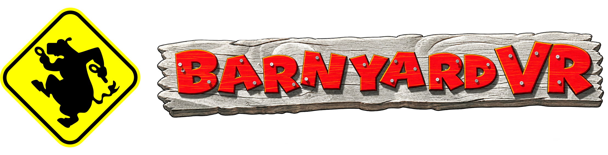

BarnyardVR is a community-made OpenXR VR port of *Barnyard*, based on [OpenBarnyard](https://github.com/InfiniteC0re/OpenBarnyard).

## Notes

> [!IMPORTANT]
> **SUPPORT THE DEVELOPERS OF THE TOSHI ENGINE**
>
> We do not own the Toshi Engine in any way, shape or form, and this project would not have been possible had they not developed TOSHI in the first place. The Toshi Engine is currently owned by [THQ Nordic](https://www.thqnordic.com); we highly urge you to follow & support their projects if you like this project!

> [!WARNING]
> **DO NOT USE THIS DECOMPILATION PROJECT AS A MEANS TO PIRATE BARNYARD OR ANY OTHER TOSHI GAMES!**
>
> We do not condone using this project as a means for piracy in any form. This project was made with love and care for the source material and was created for purely educational purposes.

## Features

- First-person VR gameplay with physical OpenXR controllers and controller-specific prompts.
- Aim milk squirts by looking, with VR-friendly aiming and minigame interfaces.
- Head-relative movement and UI options, with floor-aware height in supported views.
- Modern and Classic controller layouts, snap turning, and controller vibration.
- Adjustable VR resolution and anti-aliasing, with a desktop mirror.

## Installation

1. Install a legally obtained Windows copy of *Barnyard* and have an OpenXR-compatible PC VR headset and runtime set up.
2. Download the Windows ZIP from [GitHub Releases](https://github.com/Break-Ben/BarnyardVR/releases). Select a pre-release if that is the version you want to use.
3. Extract the ZIP contents into the *Barnyard* game folder, alongside its existing `Data` folder. Merge folders if prompted; keep the original game files.
4. Start your VR runtime, connect your headset and controllers, and launch `BarnyardVR.exe` from the game folder.

The release does not include the original game's assets. Physical VR controllers, a gamepad, or keyboard and mouse can be used; hand tracking is not supported.

## Settings

Open **Options → VR Settings**. Defaults are shown in bold; resolution and MSAA changes require a restart.

| Setting | Values | Description |
| --- | --- | --- |
| Control Layout | **Modern**, Classic | Choose the controller button layout. |
| Snap Turning | **Disabled**, 15°, 30°, 45°, 60°, 90° | Turn by a fixed angle with the stick. |
| Movement | **Fixed**, Head Relative | Choose whether on-foot movement follows the headset's facing direction. |
| UI Position | **Fixed**, Head Relative | Keep the interface fixed or let it follow your view where supported. |
| Vibration | **On**, Off | Enable or disable controller vibration. |
| Resolution | 50–200% in 10% steps; **100%** | Set VR render resolution relative to the runtime recommendation. |
| MSAA | Off, **2x**, 4x, 8x | Set VR anti-aliasing; unsupported levels fall back to a lower level. |
| Debug HUD | **Off**, On | Show VR diagnostic information. |

## Content Disclosure

- The original *Barnyard* game and its assets were not created using AI. BarnyardVR uses files from your own legally obtained copy of the game.
- Thank you to [InfiniteC0re](https://github.com/InfiniteC0re), the author of [OpenBarnyard](https://github.com/InfiniteC0re/OpenBarnyard), from which this port is forked and on which it is heavily based, for extensive manual reverse engineering and AI-assisted decompilation work.
- AI was used heavily to write and adapt code for the BarnyardVR port.

## Building

### Windows

Building on Windows requires:

- Visual Studio 2026 with the Desktop development with C++ workload and Windows SDK

Clone the repository with the following commands:

	git clone https://github.com/Break-Ben/BarnyardVR.git
	cd BarnyardVR
	git submodule update --init --recursive
	./GenerateProjects-WIN-DX11-VS2026.bat

Then open the generated solution file with Visual Studio and build it. The Windows game executable is named `BarnyardVR.exe`.

### Drafting a release

The repository's root `VERSION` file contains the release version in SemVer format (currently `0.9.0`). To prepare a release, change it to the next version (for example, `0.10.0` or `1.0.0-rc.1`) in a pull request and merge that PR to `main`.

The **Build and draft release** GitHub Action then generates the same VS 2026 DX11 Win32 solution, builds the `Release` / `Win32` configuration, and packages `bin\Release_Win32_x86_DX11\OpenBarnyard` as a ZIP attached to a **draft** GitHub release tagged `v<version>`. GitHub generates the release notes from merged PRs since the previous published release; PRs can be grouped using the `breaking`, `enhancement`/`feature`, and `bug`/`bugfix` labels. Apply `skip-changelog` to omit a PR from the notes.

The action never publishes a release. Review and edit the draft's title, notes, and ZIP in GitHub, then publish it yourself when ready. A draft must be published or deleted before the next version bump is processed. To retry a failed preparation without changing the version, run **Build and draft release** manually from the Actions tab. The workflow requires a Windows runner with Visual Studio 2026 (including the C++ build tools); if GitHub's hosted `windows-latest` image does not yet include VS 2026, the build step will fail with a clear message and the workflow must be run on a suitable Windows runner.

## Contributing

The project is open to any kind of contributions!

## Third-Party libraries
- [premake](https://github.com/premake/premake-core)
- [tracy](https://github.com/wolfpld/tracy)
- [fmod](https://fmod.com/)
- [Opcode](http://www.codercorner.com/Opcode.htm)
- [OpenXR loader](https://github.com/KhronosGroup/OpenXR-SDK)
- [Dear ImGui](https://github.com/ocornut/imgui)
- [DirectXTex](https://github.com/microsoft/DirectXTex)
- [MinHook](https://github.com/TsudaKageyu/minhook)
- [stb](https://github.com/nothings/stb)
- [Bink Video](https://www.radgametools.com/bnkmain.htm)
- [JsonCpp](https://github.com/open-source-parsers/jsoncpp) (included with the OpenXR loader)
- [GLEW](https://github.com/nigels-com/glew), [SDL2](https://github.com/libsdl-org/SDL), [GLM](https://github.com/g-truc/glm), and [Detours](https://github.com/microsoft/Detours) (other renderers and SDK tools)
